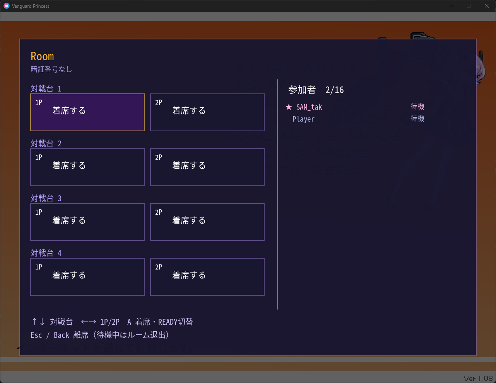

# ヴァンガードプリンセスM

開発版のOnline VS（アカウント不要接続・Epicアカウント / EOS）の設定・起動手順は
[技術メモ](TechnicalDocuments/0162-online-vs-eos.md)を参照。ソースから起動する場合、エンジンとABIが一致するEOS拡張とSDKランタイムを `native/` に配置する必要がある。

[ヴァンガードプリンセス](http://suge9.blog58.fc2.com/)を最新のOS環境でも不自由なく動作する用、
格闘ゲームツクール2ndの実行ファイルではなく独自のプログラムで動作するようにしたものです。

## ダウンロード

ページ右端の [Release](../../releases) から、最新版をダウンロードしてください。

zip もしくは tar.gz を解凍後、中にある [README](distribution/README.ja.md) に従ってセットアップを
進めてください。

> [!NOTE]  
> このパッケージにはヴァンガードプリンセスの画像素材・音声素材は一切含まれていません。
> 動作にはオリジナルのヴァンガードプリンセスが必要です。
