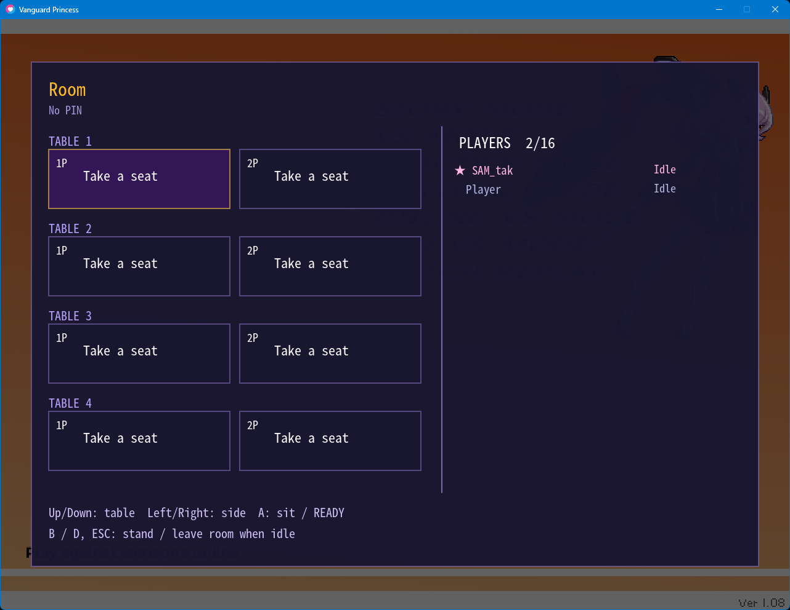

# Vanguard Princess M

The development build's Online VS uses EOS with accountless Device ID or Epic account login. Running from source
requires an engine-compatible EOS extension and SDK runtime in `native/`; see the
[setup notes (Japanese)](TechnicalDocuments/0162-online-vs-eos.md).

[Vanguard Princess](http://suge9.blog58.fc2.com/) running on its own program instead of the
Fighter Maker 2nd executable, so that it works without trouble on today's operating systems.

## Download

Download the latest version from [Releases](../../releases) on the right side of this page.

Extract the zip or tar.gz, then follow the [README](distribution/README.md) inside to set it up.

> [!NOTE]  
> This package contains none of the Vanguard Princess images or sounds.
> You need the original Vanguard Princess to play.
