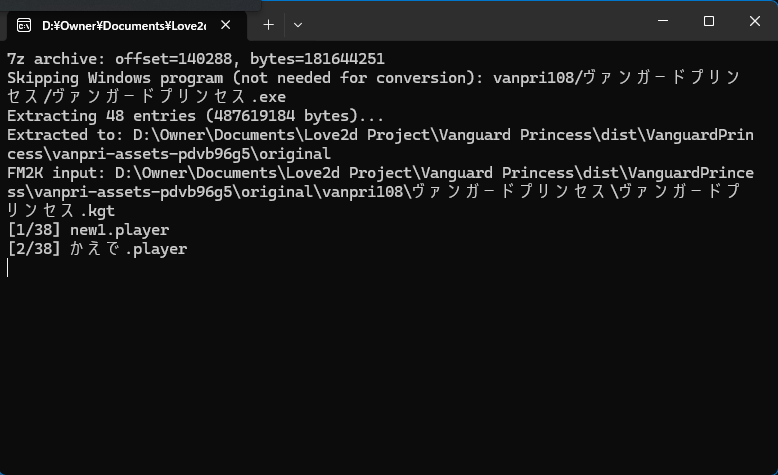
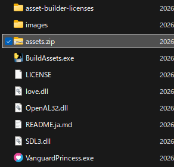

# Vanguard Princess M

This is **Vanguard Princess** running on its own program instead of the Fighter Maker 2nd executable,
so that it works without trouble on today's operating systems.

## How to play

### Get the original Vanguard Princess

This package contains none of the original Vanguard Princess images or sounds.
First, download the latest version of the original game, `vanpri108.exe`.

- [Freem!](https://www.freem.ne.jp/win/game/2302)
- [Vector](https://www.vector.co.jp/download/file/win95/game/fh655758.html)

If you have already played it and have the extracted "ヴァンガードプリンセス" folder, you can use that folder instead.

### Windows

Drag and drop `vanpri108.exe`, or the folder it was extracted to, onto `BuildAssets.exe` included in this package.

Extraction of the images and sounds starts as shown below.



Wait for it to finish (it takes a while, about five minutes). When `assets.zip` has been created,
you are ready. Press Enter to close the window.



Now double-click `VanguardPrincessM.exe` to play.

### macOS

Open Terminal in the folder where you extracted the package (the folder containing `BuildAssets` and
`VanguardPrincessM.command`) and run:

```sh
./BuildAssets ~/Downloads/vanpri108.exe assets.zip
```

Change `~/Downloads/vanpri108.exe` to wherever you actually downloaded it.

After a while (it takes about five minutes), `assets.zip` should be created.

The macOS version is not signed, so it cannot run as is. Allow it to run by entering the following command
in Terminal (adjust the folder name to where you extracted it):

```sh
xattr -dr com.apple.quarantine VanguardPrincessM
```

Then, in the same Terminal, enter

```sh
./VanguardPrincessM.command
```

or double-click `VanguardPrincessM.command`, and the game should start.

> [!NOTE]
> I do not have a Mac, so this has not been tested, and the game is not yet packaged as a regular
> Mac application (`.app`). If you have a Mac, pull requests with fixes would be very welcome.

### Linux

Open a terminal in the folder where you extracted the package (the folder containing `BuildAssets`,
`VanguardPrincessM`, and so on) and run:

```sh
./BuildAssets ~/Downloads/vanpri108.exe assets.zip
```

Change `~/Downloads/vanpri108.exe` to wherever you actually downloaded the original game.

After a while (it takes about five minutes), `assets.zip` should be created.

Then, in the same terminal, enter

```sh
./VanguardPrincessM
```

and the game should start.

### Configuring controls

There is no in-game interface for configuring controls yet, but you can change keyboard and gamepad bindings by editing `settings.json` directly.

The settings file is located at:

- Windows: `%APPDATA%\vanguard-princess-m\settings.json`
- macOS: `~/Library/Application Support/vanguard-princess-m/settings.json`
- Linux: `~/.local/share/vanguard-princess-m/settings.json`

Run the game once to create the file, then close the game before editing it. Open it in a text editor and edit the `input` section shown below:

```json
    "input": {
        "gamepad1": {
            "a": "a",
            "b": "x",
            "back": "back",
            "c": "y",
            "d": "b",
            "down": "dpdown",
            "e": "rightshoulder",
            "f": "leftshoulder",
            "left": "dpleft",
            "right": "dpright",
            "start": "start",
            "up": "dpup"
        },
        "gamepad2": {
            "a": "a",
            "b": "x",
            "back": "back",
            "c": "y",
            "d": "b",
            "down": "dpdown",
            "e": "rightshoulder",
            "f": "leftshoulder",
            "left": "dpleft",
            "right": "dpright",
            "start": "start",
            "up": "dpup"
        },
        "keyboard1": {
            "a": "z",
            "b": "x",
            "c": "c",
            "d": "a",
            "down": "down",
            "e": "s",
            "f": "d",
            "left": "left",
            "right": "right",
            "up": "up"
        },
        "keyboard2": {
            "a": "l",
            "b": "semicolon",
            "c": "quote",
            "d": "o",
            "down": "j",
            "e": "p",
            "f": "leftbracket",
            "left": "h",
            "right": "k",
            "up": "u"
        },
        "shortcuts": {
            "back": "escape",
            "reload": "f8",
            "start": "return"
        }
    },
```

`keyboard1` and `keyboard2` contain the keyboard bindings for each player, `gamepad1` and `gamepad2` contain their gamepad bindings, and `shortcuts` contains shared shortcuts. Change the values on the right to assign different keys or buttons, then save the file and restart the game.
